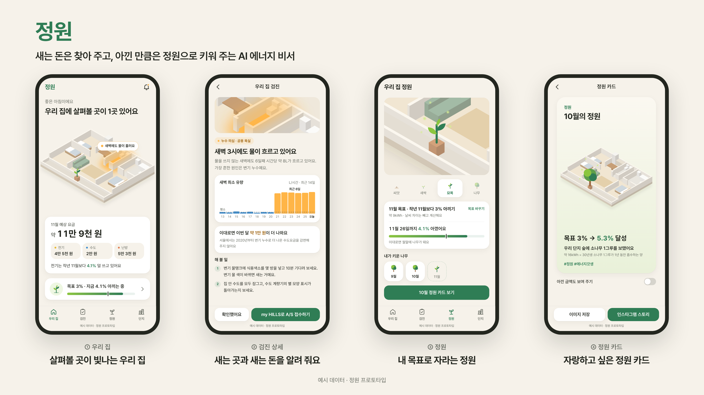
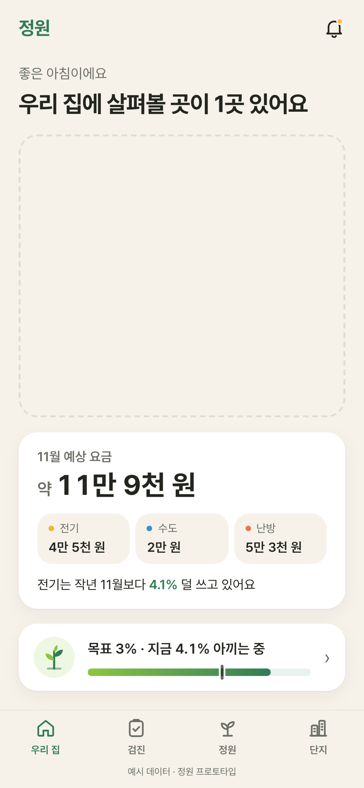
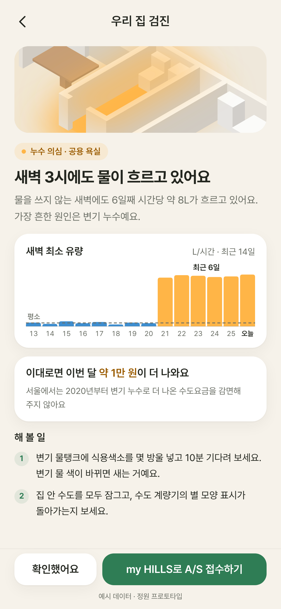
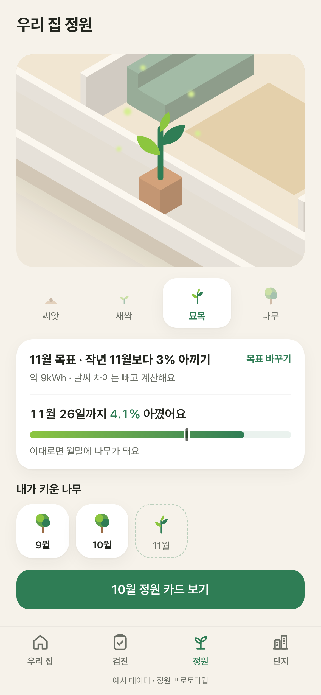
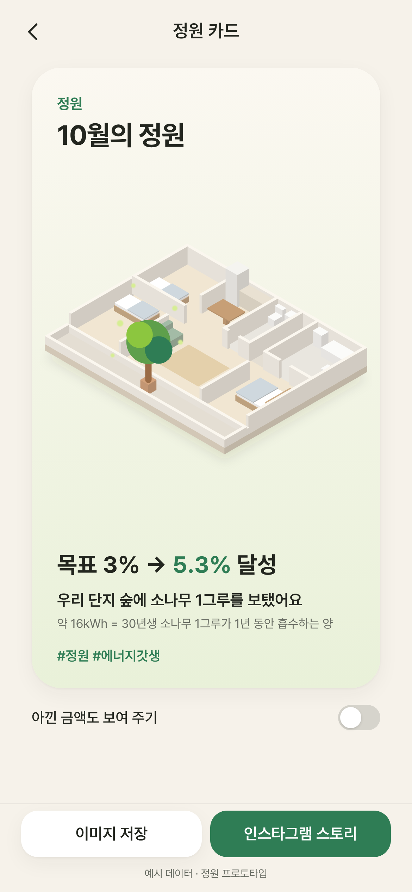
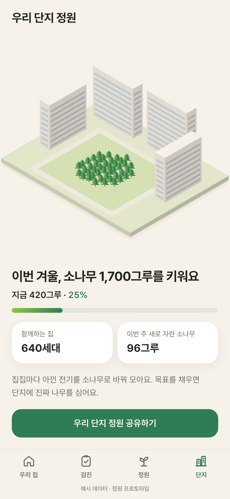
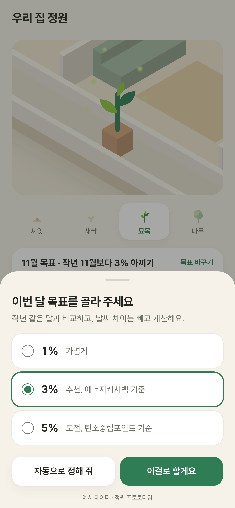

# 정원 (Jeongwon)

새는 돈은 찾아 주고, 아낀 만큼은 정원으로 키워 주는 AI 에너지 비서.



> **지금은 화면 시안이에요. 기능은 아직 없어요.**
> 앱을 켰을 때 어떻게 보이는지만 만들었어요. 화면의 숫자는 모두 **예시 데이터**(`web/src/mock`)를 계산 함수(`web/src/lib/calc.ts`)로 만든 값이고, 실제 검침 데이터는 쓰지 않았어요.

SVC Seoul AI 해커톤(with 현대건설) 지정과제 3 출품용 프로토타입입니다.

## 무엇을 하나요

- **새는 돈 찾기 — 우리 집 검진**: 비슷한 집, 작년의 우리 집과 비교해 평소와 다른 사용을 찾고, 우리 집 미니어처에서 살펴볼 곳을 따뜻한 빛으로 알려 줘요. 근거 그래프, 이대로면 더 나올 돈, 직접 해 볼 일을 함께 보여 줘요.
- **아낀 만큼 자라는 정원**: 이웃과의 순위가 아니라 내 목표(작년 같은 달 대비, 날씨 차이는 빼고 계산)로 발코니 화분이 씨앗 → 새싹 → 묘목 → 나무로 자라요. 시들거나 줄지 않아요.
- **단지 정원**: 집집마다 아낀 전기를 소나무로 바꿔 단지 숲으로 모아요. 단지 전체 합계만 보여 줘요.

## 화면

| | | |
| --- | --- | --- |
|  |  |  |
| **① 우리 집** `/`<br>살펴볼 곳이 빛나는 우리 집 | **② 검진 상세** `/checkup/leak`<br>새는 곳과 새는 돈을 알려 줘요 | **③ 정원** `/garden`<br>내 목표로 자라는 정원 |
|  |  |  |
| **④ 정원 카드** `/garden/card`<br>자랑하고 싶은 정원 카드 | **⑤ 단지 정원** `/complex`<br>단지가 함께 키우는 소나무 숲 | **⑥ 목표 고르기** `/garden/goal`<br>이번 달 목표를 골라요 |

검진 목록(`/checkup`)과 모아 보기(`/showcase`)도 있어요. 화면 명세는 [docs/SCREENS.md](docs/SCREENS.md)에 있어요.

## 만든 원칙

- 화면의 숫자는 예시 입력값을 계산 함수로 만든 값만 써요. 명세의 표시값이 그대로 나오는지 테스트로 확인해요.
- 순위·등수가 없어요. 점검 표시는 빨간 경고 대신 따뜻한 빛으로 해요.
- 가전별 사용량을 쪼개 추정하지 않아요. 미니어처의 빛은 '가장 의심되는 점검 위치'예요.
- 공유 카드에 동·호수와 날짜·시간대를 넣지 않아요. 다른 집 숫자는 10세대 이상 집계로만 보여 줘요.
- 그림은 모두 SVG로 직접 그렸고, 실제 브랜드의 로고·이미지는 쓰지 않았어요. 글꼴은 [Pretendard](https://github.com/orioncactus/pretendard)(SIL OFL 1.1)예요.

## 실행

```bash
cd web
npm install
npm run dev
```

http://localhost:3000 에서 열려요. 휴대폰 폭(390px)에 맞춰 만들었어요.

```bash
cd web && npm run lint && npm run test && npm run build   # 검증
cd web && npm run shots   # 스크린샷 → docs/screenshots/ (처음 한 번: npx playwright install chromium)
```

## 구조

- `web/` — Next.js 16(App Router) · TypeScript · Tailwind CSS v4 · Vitest · Playwright
  - `src/mock/` 예시 데이터(입력값만), `src/lib/calc.ts` 화면 숫자 계산, `src/config/constants.ts` 요금 단가·환산 계수(출처 또는 TODO)
  - `src/lib/iso.ts` 아이소메트릭 투영, `src/components/` 미니어처·단지 그림·아이콘
- `docs/` — 화면 명세(SCREENS.md), 작업 계획(PLAN.md), 다음 단계 명세(SPEC_P0.md), 스크린샷

## 예시 데이터와 출처

- 전기요금은 주택용 누진(기타계절) 전력량요금만 계산해요. 기본요금·부가세 등은 아직 넣지 않았어요.
- 수도·지역난방 단가와 누수 판단 기준은 임시값이에요(`constants.ts`의 TODO).
- 소나무 환산: 30년생 소나무 1그루의 연간 CO₂ 흡수량(국립산림과학원) ÷ 전력 배출계수.

## 다음 단계

합성 세대 데이터로 실제 계산(비교군·기준선, 누수·대기 전력 탐지, 목표 진행률)을 붙여요. 요구사항은 [docs/SPEC_P0.md](docs/SPEC_P0.md)에 있어요.
